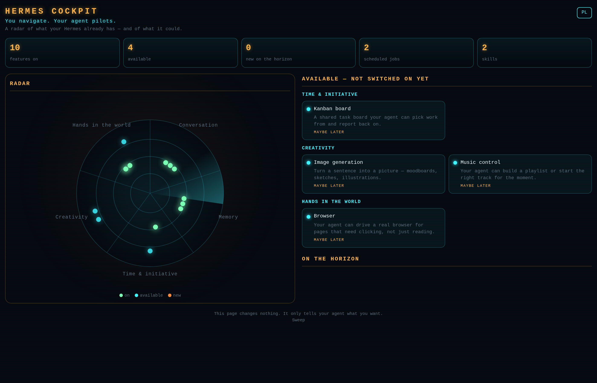

# hermes-cockpit 🛰



**You navigate. Your agent pilots.**

Every week, new Hermes plugins and features appear — and for anyone who is not a
programmer, "there is a new thing you could install" is not help, it is noise.
`hermes-cockpit` turns that noise into one glowing page:

- **A radar** of what your Hermes already has switched on — grouped into five
  sectors: *Conversation, Memory, Time & initiative, Creativity, Hands in the world*.
- **A side panel** of features and catalog plugins that exist but are **not running
  yet**, grouped by theme, each with a plain-language "what this gives you".
- **On the horizon** — the plugins that are genuinely **new in the catalog** since
  the last sweep, with a recommendation: **TURN ON / MAYBE LATER / NOT NOW**.

Every item has a **"Turn on → talk to my agent"** button. It copies a short prompt
to your clipboard:

> Cockpit: I want to turn on *<name>*. What will it do for us and how do we fly?

Paste it to your agent and *it* explains and sets things up — in conversation, at
your pace. **The cockpit itself never installs, enables, or edits anything.**

Authorship: **Agata Śliwińska × Drift**. License: **MIT**.

---

## Install

From a git URL (once the repository is public):

```bash
hermes plugins install https://github.com/<owner>/hermes-cockpit-plugin
hermes plugins enable hermes-cockpit
```

Manual install (no git):

```bash
mkdir -p ~/.hermes/plugins/hermes-cockpit
cp -r ./* ~/.hermes/plugins/hermes-cockpit/
hermes plugins enable hermes-cockpit
```

`~/.hermes` is your Hermes home; if you use profiles or a custom home, use
`$HERMES_HOME/plugins/hermes-cockpit` instead.

Requirements: **Hermes ≥ 0.21**, Python 3.10+. No extra packages, no API keys.

## Use

In any session:

```
/cockpit
```

or just ask:

> What can my Hermes do that I'm not using yet? What's new in the plugin catalog?

The agent calls the `cockpit` tool, writes a personal line per item, and renders
the page to:

```
<HERMES_HOME>/cockpit/cockpit.html
```

Open it in any browser. It is one self-contained HTML file — no internet, no
assets, no tracking. There is an **EN / PL** toggle in the corner (English by
default, Polish included).

### The tool, directly

| action    | returns |
|-----------|---------|
| `cockpit(action="scan")`    | raw inventory JSON |
| `cockpit(action="horizon")` | catalog diff vs. the saved snapshot |
| `cockpit(action="summary")` | a briefing the agent writes personal lines from |
| `cockpit(action="render")`  | writes `cockpit.html`, returns its path |
| `cockpit(action="all")`     | everything above in one call (what `/cockpit` does) |

`render` accepts `notes={"<item id>": "your sentence"}` so the agent's own
wording replaces the generic catalog text, and `lang="pl"` for Polish.

### Keep the horizon fresh

Ask your agent to schedule the sweep (it will offer this — it will not create it
behind your back):

```bash
hermes cron create "every 2d" \
  "Run the cockpit horizon sweep and tell me only if something genuinely new and useful appeared: cockpit(action='horizon'). If new_count is 0, reply with just [SILENT]." \
  --name "Cockpit horizon" --deliver origin
```

## Privacy

- **Local by default.** The inventory is read from your own Hermes home, read-only.
- **One network call, ever:** the public plugin catalog JSON
  (`https://hermes-agent.nousresearch.com/docs/api/plugin-catalog.json`), which is
  what the "on the horizon" section is built from. Nothing about you is sent.
- **No secrets.** The cockpit never reads `.env`, `auth.json`, or any credential
  file. It reports *counts and names of mechanisms*, never their contents.
- **Offline-friendly.** If the catalog is unreachable, the last snapshot is reused
  and the page says so.
- **Read-only.** It never installs, enables, disables, or edits anything.

## Uninstall

```bash
hermes plugins remove hermes-cockpit
```

State lives only in `<HERMES_HOME>/cockpit/` (`seen.json`, `catalog-cache.json`,
`cockpit.html`) — delete that folder too if you want a clean slate.

## What's inside

```
hermes-cockpit-plugin/
├── plugin.yaml                 # manifest (name, version, provides_tools: [cockpit])
├── __init__.py                 # register(ctx): tool + /cockpit command + bundled skill
├── cockpit/
│   ├── home.py                 # locate HERMES_HOME, read config read-only, state paths
│   ├── inventory.py            # the radar's raw facts
│   ├── capabilities.py         # the curated, generic map of Hermes capabilities
│   ├── horizon.py              # fetch + diff the public catalog
│   ├── recommend.py            # deterministic TURN ON / MAYBE LATER / NOT NOW
│   ├── render.py               # the single self-contained HTML page
│   └── api.py                  # one entry point for tool, command and tests
├── skills/hermes-cockpit/SKILL.md   # how the agent flies it
├── tests/test_cockpit.py       # scan, horizon diff, render, JS syntax, no-secret-read
├── CATALOG-SUBMISSION.md
└── README.md
```

## Tests

```bash
/opt/hermes/.venv/bin/python tests/test_cockpit.py     # or: pytest tests/
```

They build a throwaway `HERMES_HOME`, exercise scan / horizon / render, and run
`node --check` on the generated JavaScript. Nothing touches a real Hermes.

## License

MIT — see [LICENSE](LICENSE).
